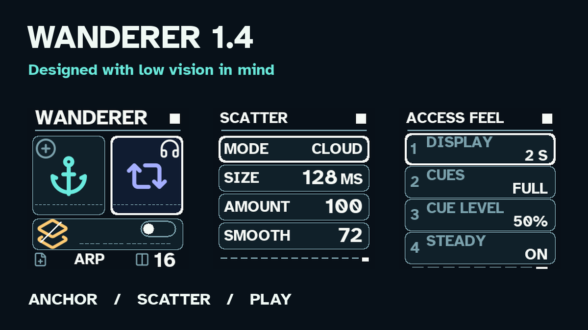

# Wanderer 0.9 for M-VAVE FM-1

**Work in progress · experimental pre-release · tested on the author’s FM-1, with successful rollback.**

I have physically tested Wanderer 0.9 on my own M-VAVE FM-1 and successfully rolled back to another firmware. Wanderer remains a work in progress.

See [hardware testing](docs/HARDWARE_TESTING.md) for the recorded scope.

I’m Nicholas James, a visually impaired musician and the person behind [Low Vision Music](https://www.lowvisionmusic.info). Wanderer explores an instrument built around large symbols, clear positions, recoverable actions and short audible cues. I’d welcome feedback from FM-1 users, especially musicians with low vision.

Download the FM-1 firmware, matching source bundle, preset catalog and sound tour from [Releases](https://github.com/spinnicholas/lvm-wanderer-fm1/releases). Read the [current status](docs/STATUS.md), [installation notes](docs/RELEASE_0.9.md), and [quick start](docs/QUICK_START.md) before trying it. The firmware is experimental: back up your work, retain a known-working recovery package, and install at your own risk.

This image is a host-rendered framebuffer capture. The audio tour is a host render, not a recording of a physical FM-1. Package identity: `FM-1_929`. SHA-256: `c6c0a2829a5c1fe5959cb0d302c4de152b97fe3f29e469c400d1fbaefa236dc9`.

## 0.9: one hundred sounds

Wanderer 0.9 contains 100 original, numbered patches in ten banks of ten: Foundations, Vintage Poly, Mono & Lead, Bass Lab, Plucks & Keys, FM Bells, Digital Motion, Pads & Atmospheres, Brass & Organic, and Experimental. They range from mellow analog-style voices and sub basses to short keys, two-operator phase-modulated bells and slowly blooming pads. These are broad sound-design inspirations, not emulations or copies of Moog, Roland, Arturia or Yamaha instruments. See the [numbered sound catalog](docs/WANDERER_PRESETS_0.9.md) and [engine notes](docs/WANDERER_SOUND_0.9.md).

Outside settings, turn PRESETS one step at a time to browse all 100, or turn SELECT to jump between banks while preserving the number within the bank (for example 17 to 27). The large waveform symbol and number 1–100 are the on-device identification; WANDERER remains its only word. Zoom can still be switched in settings. Existing notes keep their current patch until retriggered. A confirmed slot save remembers the selected sound. Prior 0.8 saved slots and older Wanderer slots retain their sound selection (the original three remain numbers 1–3). The 0.9 FM-1 package has been cross-compiled, exercised on a host and in fm1-emu, and physically tested on my FM-1 with a successful rollback.

## 0.8 sound characters and effects

Version 0.8 introduced original band-limited wavetable oscillators, two detuned oscillators per note, a moving two-stage filter, and three sound characters. It also added a settings page for Chorus, Delay and Reverb. The delay follows the phrase tempo with four divisions, and the reverb has size and damping controls. See `docs/WANDERER_SOUND_0.8.md` for that release's details. All of these effects remain in 0.9.

## 0.7 sound refinement

The four-voice synth now keeps the fundamental present as Melt adds a softer second harmonic. A gentle per-voice low-pass contour, slower release and a quiet two-tap stereo ambience give phrases more body and space. The effect uses a fixed 16 KiB buffer in the FM-1's pool memory; it does not record or resample audio. Short confirmation tones taper at the end. A host-rendered musical example and the detailed checks are described in `docs/WANDERER_SOUND_0.7.md`. The 0.7 sound engine has not been cross-compiled or tested on physical FM-1 hardware.

## 0.6 visual refinement and settings

Version 0.6 established the current full-screen visual language. **Wanderer is the only word on the instrument display.** The home screen has two large phrase orbits, each with a 64-pixel symbol and 16 visible positions. A literal anchor identifies the protected original; paired arrows identify the evolving memory. Layer has a full-width panel and an oversized switch. The system settings screen contains palette, Zoom and reduced motion. Zoom gives the active phrase a 96-pixel symbol. See `docs/WANDERER_UI_0.6.md` for the visual changes.

This is the first playable software expression of Low Vision Music's Wanderer concept. It is a **new application on Dinghy's FM-1 platform**, not a four-track SLOOP update.

**Early hardware test completed on my FM-1, including a successful rollback.** Wider device coverage and detailed measurements of audio timing and flash writes are still to be documented. Back up your work before switching firmware.

A 16-step phrase is captured as note and velocity events. SAVE catches the first phrase as an immutable Anchor. The working memory evolves with MELT (timbre), DRIFT (bounded pitch variation), and DECAY (gradual velocity aging). A second phrase can be layered. GLO commits a variation into a new branch while keeping the Anchor. LFO alternates the original and the living memory without stopping playback. No audio samples or microphone input are captured.

## Five-minute tour

PLAY starts a 16-step loop at 112 BPM. REC enables quantized note capture; play a few keys and press REC again to finish. SAVE catches the phrase as the Anchor. Turn KNOB 1, 2, and 3 for MELT, DRIFT, and DECAY. EDIT selects the layer; REC and play keys to overdub it. GLO bakes a new branch, preserving the Anchor. LFO plays the original, then returns to the living memory. HOME clears a dialog or restores orientation without clearing the phrase or stopping playback.

| Physical control | Wanderer action |
|---|---|
| PLAY | Start or stop the loop |
| REC | Toggle quantized capture into memory or the selected layer |
| SAVE | Catch the first working phrase as the protected Anchor |
| EDIT | Toggle layer recording target; the layer keeps playing when off |
| GLO | Commit an evolved branch, keeping the Anchor |
| LFO | Revisit original Anchor; press again for living memory |
| HOME | Return to living Home, cancel a prompt or close settings; leave music playing |
| ENV | Undo one recent capture, Catch, layer erase, branch, load, or new session |
| FX, then SEL | Clear the layer after confirmation |
| Hold FX for 1.6 seconds, then SEL | Start a new session after confirmation; HOME cancels |
| SEQ, then SEL | Save slot 1 while stopped |
| ARP, then SEL | Load slot 1 while stopped |
| SEL | Open settings; confirm a prompt; toggle the selected setting while inside settings |
| SELECT encoder | Move among settings; outside settings, jump between ten sound banks. Zoom remains in settings |
| PRESETS encoder | Browse sounds 001–100; in settings, switch between system and effects pages |
| ALGORITHM encoder | Tempo, 60–180 BPM; in effects, delay division or reverb size |
| KNOB 1–3 | Melt, Drift, Decay (0–127) |
| KNOB 4 | Master level; in effects, amount for the selected effect |
| OCT− / OCT+ | Keyboard octave |

In settings, turn SELECT to choose a row and SEL to switch it. PRESETS moves between the system page (light palette, Zoom, reduced motion) and the effects page (Chorus, Delay, Reverb). On the effects page, KNOB 4 sets the selected amount. ALGORITHM sets delay division or reverb size; KNOB 3 sets delay feedback or reverb damping. The temporarily displayed number shows that secondary value. HOME closes settings. PLAY and keyboard performance continue while settings is open. Settings and sound choice are included when you explicitly save the slot while stopped; toggling never writes flash during performance. Older Wanderer 0.1–0.7 slots are migrated on Load with the new effect defaults.

Every important action has a short audible cue and a distinct visual symbol. These cues do not speak note names or values. The screen remains important for complete information; this is not yet a fully screen-independent instrument. Each phrase orbit shows sixteen positions; bright nodes are occupied steps and the larger open node is the play position. Colour is supplemented by separate symbol shapes and fixed positions. The layer shows its sixteen steps on a horizontal rail.

Saving is explicit and refused during playback or recording because flash writes are not qualified under audio load. Slot 1 uses a new LVM magic, version and the platform's CRC storage. It does not import old SLOOP projects. A saved slot is only loaded after confirmation.

## Build and tests

Set `JIELI_TOOLCHAIN` and `AC79_SDK` to the pinned dependencies described in Dinghy's [build instructions](README-DINGHY.md), then run `sh build.sh --release 0.9` and `sh tests/run_wanderer_tests.sh`. The Atkinson font, icons, oscillator tables, and patch table are generated offline from included sources. See [release verification and install notes](docs/RELEASE_0.9.md) for this exact package.

See [architecture and source review](docs/WANDERER_ARCHITECTURE.md), [testing and limits](docs/WANDERER_TEST_REPORT.md), [attribution](LICENSING.md), and [Dinghy's original README](README-DINGHY.md).

GPL-3.0-only firmware and build scripts, with Atkinson Hyperlegible Bold under SIL OFL 1.1. Source and applicable third-party notices are included. LVM Wanderer is not affiliated with M-VAVE or the upstream authors.
