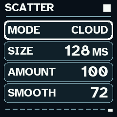
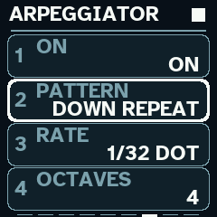
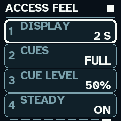
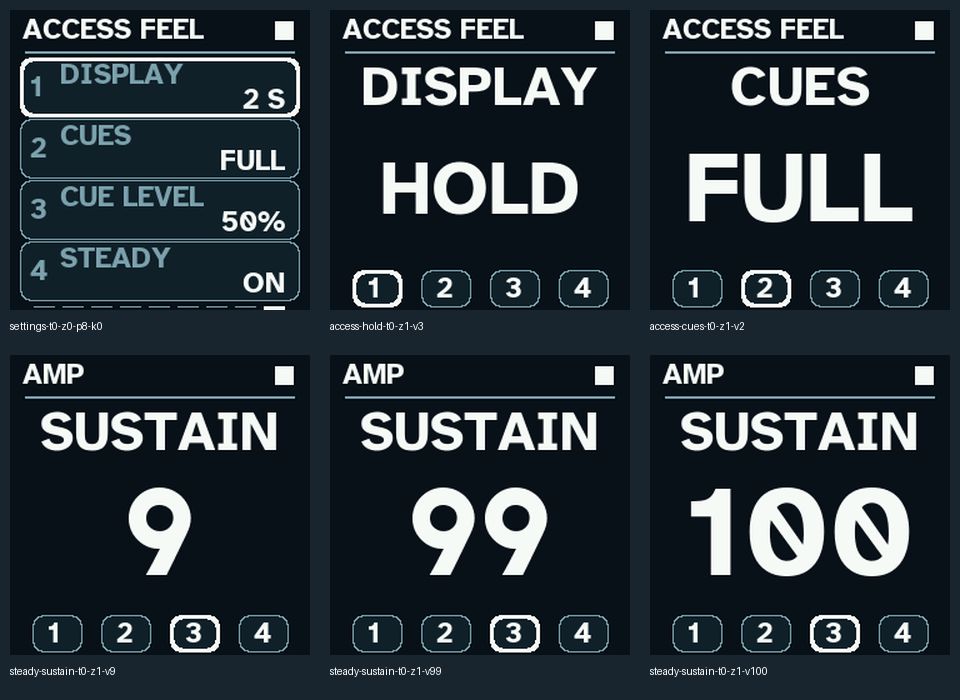

# LVM Wanderer 1.4 for M-VAVE FM-1

> **Wanderer 1.7 RC4 has been thoroughly hardware-tested by its author.** The exact firmware and matching source archive have been verified, and [release details, compatibility notes and checksums](docs/RELEASE_1.7_RC4.md) are available. **The RC4 download is not hosted on GitHub yet.** The 1.4 link below remains the latest installable GitHub release until RC4 assets are uploaded. See the [RC4 hardware-test record](docs/HARDWARE_TESTING_1.7_RC4.md).


**Current release: 1.4 · Author hardware-tested · Designed with low vision in mind**

Wanderer is a four-voice event-memory synthesizer from [Low Vision Music](https://www.lowvisionmusic.info). Protect an idea as an Anchor, evolve a working copy with Melt and Drift, add a second layer, then reshape the result with musical Scatter, Print and effects. I designed it as a visually impaired musician, with large high-contrast symbols, consistent physical controls and optional sound feedback.

[Download the tested firmware](https://github.com/spinnicholas/lvm-wanderer-fm1/releases/download/v1.4.0/LVM-Wanderer-1.4-RC6-FM1.fwsc) · [Release and what’s new](https://github.com/spinnicholas/lvm-wanderer-fm1/releases/tag/v1.4.0) · [Full guide](https://spinnicholas.github.io/lvm-wanderer-fm1/) · [Quick start](docs/QUICK_START_1.4.md)

## What is new in 1.4

The sound engine has fuller subtractive oscillator blends, stronger sub bass, a four-pole low-pass path, finer phase distortion and a rebalanced bank of 100 sounds. Scatter now has eight modes on one page: Mixed, Slices, Hops, Reverse, Tape, Cloud, Pitched and Fills. Size, Amount and Smooth shape the result before chorus, delay and reverb.

The arpeggiator adds 13 patterns, 12 timing options, octave range, gate, swing, latch and USB/TRS clock input. Generated notes and their lengths can be recorded into Memory or Layer. Four main knobs match the displayed parameters throughout the editor and settings pages.

Adaptive Zoom enlarges words to fit and wraps longer values where useful. Steady numeric Zoom keeps numbers the same size across a parameter’s range and unit changes. Display hold offers two, five or ten seconds, or Hold until dismissed. Cues offers Off, Actions and Full with a separate level; Full adds rising/falling switch patterns and range landmarks. Press **HOME + EDIT together**, then release both, to toggle Zoom without leaving the current page.

## Current screens

| Musical Scatter | Arpeggiator | Access Feel |
| --- | --- | --- |
|  |  |  |



[Boot splash](docs/screenshots-1.4/splash.png) · [Accessibility menu](docs/screenshots-1.4/accessibility.png) · [Stable time/frequency units](docs/screenshots-1.4/steady-units.png) · [Audio cue preview](docs/audio-1.4/cues.wav)

## Hardware confirmation and exact download

On November 2, 2026, Nicholas confirmed that this exact RC6 build passes his standard physical FM-1 tests and is ready to publish. The public 1.4 release retains that tested binary without recompiling or changing its embedded version label. [Hardware confirmation](docs/HARDWARE_TESTING.md) · [Software verification](docs/TEST_REPORT_1.4_RC6.md)

Filename: `LVM-Wanderer-1.4-RC6-FM1.fwsc`. Identity: `FM-1_929`. Size: 612,196 bytes. SHA-256:

```text
9135b62169409efb73a6492561673bb5465979563824605956ab3316c50d5b32
```

## Install and keep your projects

Use the compiled `.fwsc` download with your FM-1 update method. The source/release bundle includes the Python installer and [installation and recovery instructions](docs/INSTALL_AND_RECOVERY.md). Start at a lower master level: the modern engine has 6 dB more gain than 1.3 RC4.

New saves use project format v8. Older Wanderer projects import without overwriting their original slots; save conversions into spare slots if you need to return to an older version. Printed audio remains RAM-only and must be recorded externally. External clock controls the arpeggiator; event-memory playback and printed audio keep their existing clock.

Build the exact embedded RC6 version with `sh build.sh --release 1.4-RC6`, following [the pinned toolchain instructions](README-DINGHY.md). GPL-3.0-only with retained platform, font and icon notices in [LICENSING.md](LICENSING.md). Nicholas James / Low Vision Music. Independent firmware; not affiliated with M-VAVE or the original platform authors.

You can also try LVM Wanderer in the browser, no flashing needed, in the free community [FM-1 Emulator](https://fm1-emulator.atst.tools/).
