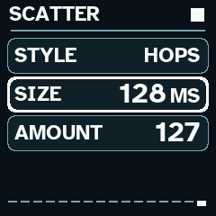
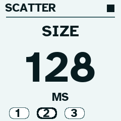
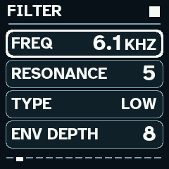
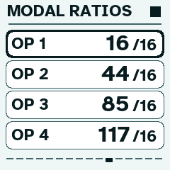
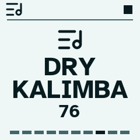
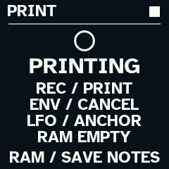

# LVM Wanderer 1.3 RC4 (Grains) for M-VAVE FM-1


*Wanderer's main Home screen, showing the protected Anchor and evolving memory. Reference capture from the retained 1.2 interface; the current RC4 editor screenshots appear below.*

**Current version: 1.3 RC4 · Hardware tested by the author · Designed with low-vision musicians in mind**

Wanderer is an experimental event-memory synthesizer for M-VAVE FM-1 from [Low Vision Music](https://www.lowvisionmusic.info). I designed Wanderer as a visually impaired musician, with large high-contrast symbols, predictable physical controls, visual layouts that do not rely only on color, and audible action cues. This is an independent musical instrument built on the FM-1 platform, not an update to SLOOP.

## Wanderer 1.3 RC4 screen gallery

The images below are actual rendered RC4 interface captures from the release guide, not concept art. [Browse all six original screenshots](docs/screenshots-1.3-rc4).


| Scatter grain sizes | Accessible light-theme Zoom |
| --- | --- |
|  |  |

| Filter controls | Modal ratios | Preset zoom |
| --- | --- | --- |
|  |  |  |



## Current firmware: 1.3 RC4

The latest author-tested candidate is **LVM-Wanderer-1.3-RC4-Grains-FM1.fwsc**. Its persistent firmware identity is `FM-1_929`; its SHA-256 is:

```
91633c4d0e3de94fd15722fce062504243c0d623437317be96434165c3b116ce
```

**Release/download status:** The 1.3 RC4 binary has been built and tested, but it has **not yet been attached to a public GitHub Release**. Do not mistake the archived 0.9 release download for the latest firmware. Follow [Releases](https://github.com/spinnicholas/lvm-wanderer-fm1/releases) for downloadable assets. Before installing, verify the entire filename and SHA-256 hash.

## What Wanderer does

Wanderer holds a protected original musical idea (Anchor) and lets you branch, transform and layer evolving event-memory phrases. It offers a bank of 100 original synthesizer sounds, chord recording with held-note gates, melodic evolution, Print, Undo/Redo, tempo-synced musical effects, and a tactile-oriented interface.

**New in RC4:** On the Scatter editor page, knobs 1–3 control Style, grain Size and Amount. Grain size offers Auto or 4, 8, 16, 32, 64 and 128 milliseconds. Unpredictable jumps, hops, repeats and dropouts can be softened with downstream chorus, delay and reverb. The signal flow is synth/playback → Scatter → Print/Melt → effects → output. New saves use project format v7, and older v6 slots can be imported without overwriting their original records.

## Tested firmware transitions

On November 1, 2026, the author reported fully testing the latest firmware on physical FM-1 hardware. The reported successful installation and return paths were:

- Previous Wanderer version ↔ Wanderer 1.3 RC4
- Official FM-1 V15 ↔ Wanderer 1.3 RC4
- SLOOP ↔ Wanderer 1.3 RC4

The report is first-party device testing, not a guarantee across all FM-1 units or every intermediate firmware version. Back up your existing music, keep the exact original firmware package for your device, and do not interrupt flashing. Different firmware families do not necessarily share project formats. A new project saved with RC4 may not load in older Wanderer versions; save migrated projects in spare slots.

For the full details, see [1.3 RC4 release notes](docs/RELEASE_1.3_RC4.md). The [original 0.9 documentation](docs/README_0.9_ARCHIVE.md) remains available for historical reference. [Source and attribution](LICENSING.md) and [Dinghy's platform README](README-DINGHY.md) are retained.

Wanderer is experimental independent firmware, not affiliated with M-VAVE or the original platform/firmware developers. GPL-3.0 applies to project code, with third-party notices as documented. The accessibility direction is a design priority, not a claim that every function is screen-free.
